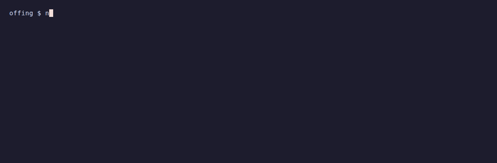
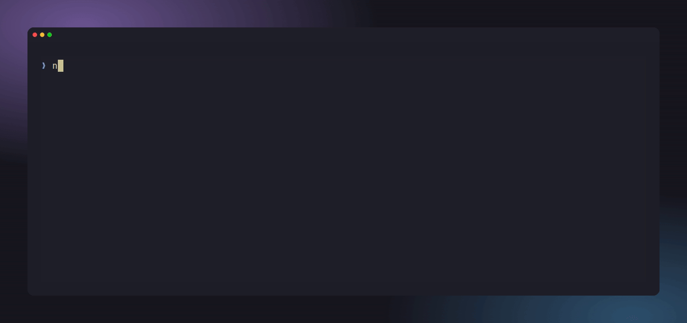
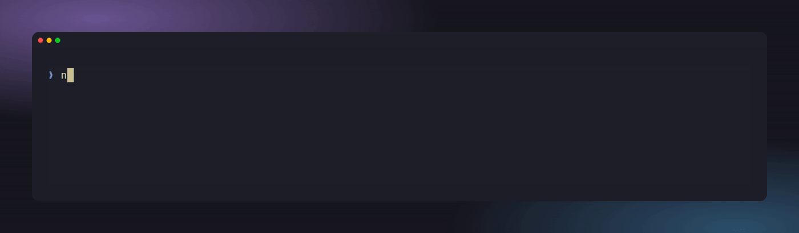
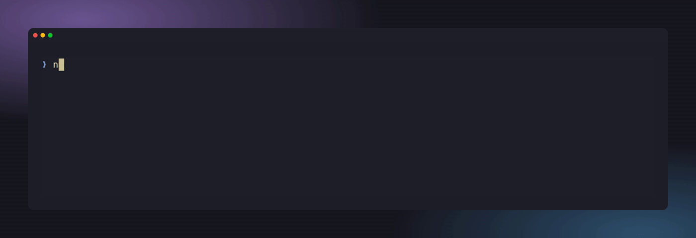
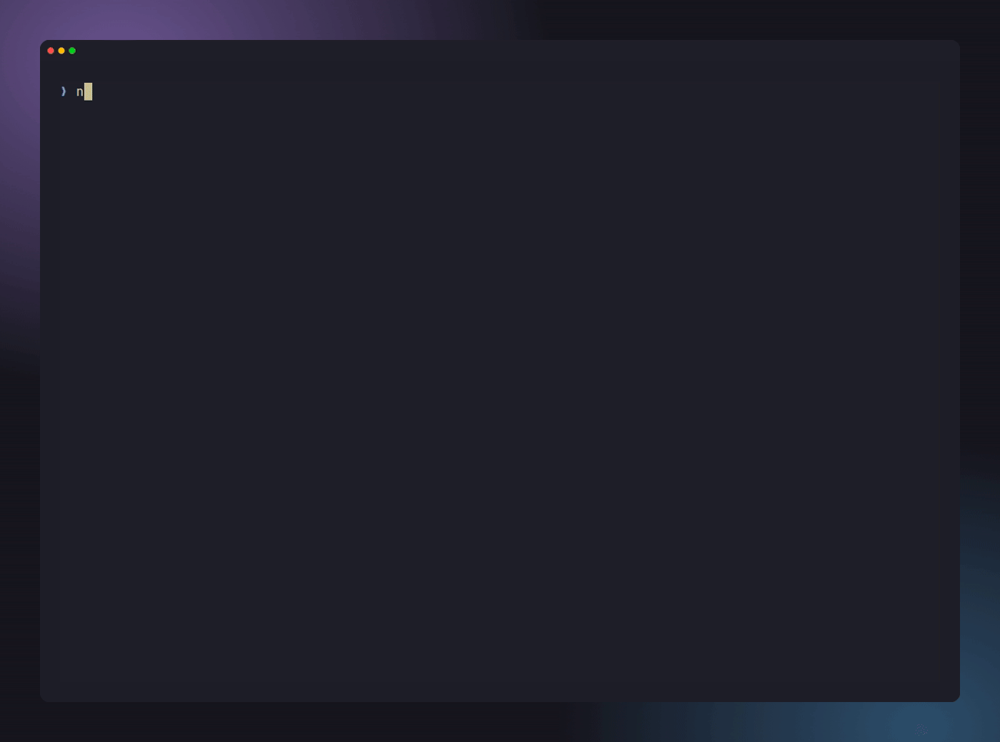
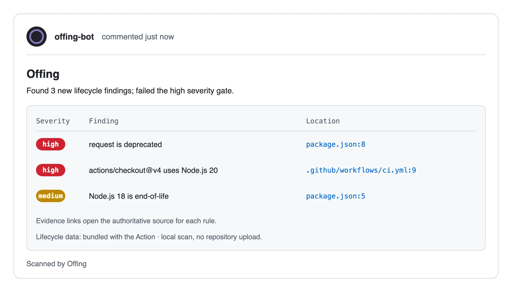

<p align="center">
  <picture>
    <source media="(prefers-color-scheme: dark)" srcset="https://raw.githubusercontent.com/velella-sh/offing/main/.github/assets/mark-night.svg">
    
  </picture>
</p>

<h1 align="center">Offing</h1>

<p align="center">
  <strong>See what's in the offing. Fix it before it lands.</strong><br>
  Local-first end-of-life and deprecation scanner for your repository.
</p>

<p align="center">
  <a href="https://github.com/velella-sh/offing/actions/workflows/ci.yml"></a>
  <a href="https://github.com/velella-sh/offing/actions/workflows/ci.yml"></a>
  <a href="https://www.npmjs.com/package/@velella/offing"></a>
  <a href="LICENSE"></a>
  <a href="https://github.com/velella-sh/offing/actions/workflows/ci.yml"></a>
  <a href="https://securityscorecards.dev/viewer/?uri=github.com/velella-sh/offing"></a>
</p>

Offing finds **end-of-life and deprecated** runtimes, packages, and GitHub Actions in your repository, at the exact file and line, each with an authoritative source, a replacement, and migration steps. It is deterministic, offline, and needs no account.

```bash
npx @velella/offing scan .
```

<p align="center">
  
</p>

```text
Offing: 1 finding
github-actions.checkout.node20:.github/workflows/ci.yml:9 .github/workflows/ci.yml:9 high actions/checkout@v5 or later
```

That is `scan --format compact` on the bundled demo project (`examples/demo`). Ask for the evidence behind one finding with `npx @velella/offing explain '<finding-id>' .`, or check a dependency before you add it:

```bash
npx @velella/offing check pkg:npm/request@2.88.2   # exits 1: deprecated, with the replacement and its source
```

Requirements: Node.js 22 or newer. Read this in: **English** · [فارسی](docs/i18n/fa/README.md).

## What you get

- **Exact location, real source.** Every finding names the file and line, links the authoritative source for the rule, and gives the replacement and migration steps. Nothing is guessed: a package with no rule reports `no-data`, never "safe".
- **Check before you add.** `check pkg:npm/request@2.88.2` answers for one dependency without scanning anything, and exits `1` when a rule at or above `--fail-on` applies.
- **Only new problems.** `baseline` records accepted findings; `scan --baseline` then reports only regressions, so a legacy repository can adopt Offing on day one.
- **Migration packets.** `context '<finding-id>' --json` hands a person or a coding agent the constraints, the affected files and usages, the sources, and suggested verification commands. Offing never runs them for you.
- **Usage, not just declarations.** For npm and Ruby it finds the imports and calls that use a deprecated package, so you see what a migration has to touch.
- **Fresh data, still offline.** Scans never touch the network. `data update` refreshes lifecycle rules from signed bundles when you ask, and refuses anything it cannot verify.
- **Works where you work.** CLI, local MCP server, GitHub Action with SARIF for code scanning, and an Agent Skill. Setup for Claude Code, Codex, Cursor, Gemini CLI, GitHub Copilot and Kilo Code is one command: `setup`.
- **Private by design.** No account needed, and no repository upload.

## See it run

<table>
<tr>
<td width="50%"><b>Check a dependency before you add it</b><br></td>
<td width="50%"><b>Evidence behind one finding</b><br></td>
</tr>
<tr>
<td width="50%"><b>Adopt on day one with a baseline</b><br></td>
<td width="50%"><b>Preview a fix as a diff</b><br></td>
</tr>
<tr>
<td width="50%"><b>See what is ending next</b><br></td>
<td width="50%"><b>Teach your coding agents</b><br></td>
</tr>
</table>

## What it covers

Runtimes, package manifests and lockfiles, CI and infrastructure files across:

Node.js, npm, Deno and Bun · Python · Go · Rust · Java and Kotlin · .NET · Ruby · PHP · Swift · Android · Dart and Flutter · Elixir · Scala · C and C++ · GitHub Actions · CI runner images · Container base images · Kubernetes APIs · Terraform · Serverless runtimes · Database runtimes · PowerShell.

The full table, with the files read and what is reported for each, is in [Ecosystem coverage](docs/ECOSYSTEMS.md). Maturity per detector is in the [compatibility matrix](docs/COMPATIBILITY.md#ecosystem-coverage).

## For coding agents

```bash
npx skills add velella-sh/offing        # the Agent Skill, listed on skills.sh
npx @velella/offing setup               # tell each coding agent in the repo to check before adding
npx @velella/offing context '<finding-id>' . --json   # migration packet for an agent
npx --yes @velella/offing mcp           # local MCP server over stdio
```

Every report has a machine-readable form. The docs are also published as [`llms.txt`](https://velella.sh/offing/llms.txt) and [`llms-full.txt`](https://velella.sh/offing/llms-full.txt). See [Agent Skills](docs/AGENT_SKILLS.md) and the [local MCP guide](docs/MCP.md).

## In CI

```yaml
steps:
  - uses: actions/checkout@v7
  - uses: velella-sh/offing@v0.1.1
    with:
      fail-on-severity: high
```



Offing annotates the pull request at the exact line, posts one summary comment with the evidence, suppresses accepted findings with a baseline, fails on the severity you choose, and uploads the complete JSON report or SARIF. Scans run on the runner, so repository contents never leave it. Pin a full commit SHA instead of a tag when you need an immutable reference. Setup, inputs, permissions and artifacts are in the [GitHub Action guide](docs/GITHUB_ACTION.md).

## Why not just Renovate?

Renovate, Dependabot, and endoflife.date each answer a question Offing does not, and Offing answers one none of them does: what is ending in this repository, and where is it used. Most repositories gain from running one of them **with** Offing, so the table states what each covers and what it does better, and links the source of every claim. Details and sources per tool are in [Offing compared with other tools](docs/compare/index.md).

| Tool | What it covers | What it does better | Evidence |
| --- | --- | --- | --- |
| [Renovate](https://docs.renovatebot.com/) | Dependency updates across the [package managers it supports](https://docs.renovatebot.com/modules/manager/), as automated pull requests | Opens the update pull requests Offing never writes, and reports npm deprecation notices for packages this registry has no rule for | [Compared with Renovate](docs/compare/renovate.md); the [differential report](docs/differential-report.md) measures both directions on pinned repositories and links the evidence for every disagreement |
| [Dependabot](https://docs.github.com/en/code-security/concepts/supply-chain-security/dependabot-security-updates) | Version updates and security updates on GitHub, each as a pull request | Version updates keep dependencies current even when nothing is vulnerable; security pull requests and alerts draw on the GitHub Advisory Database | [Compared with Dependabot](docs/compare/dependabot.md) |
| [endoflife.date](https://endoflife.date/) | EOL dates and support lifecycles for many products, served through a [public API](https://endoflife.date/docs/api) | Product breadth beyond one reviewed rule set, and a date you can check without installing anything | [Compared with endoflife.date](docs/compare/endoflife-date.md) |
| **Offing** | The lifecycle status of what the repository's files declare and use — end-of-life runtimes, deprecated packages, retired APIs — at file and line, offline | Reports that a version is out of support, not only that a newer one exists, and names the usage a migration has to touch | [What it covers](#what-it-covers), [validation](docs/VALIDATION.md), [compatibility matrix](docs/COMPATIBILITY.md) |

## Learn more

- [Quickstart](docs/QUICKSTART.md): five copy-paste steps, first scan to CI.
- [Using Offing](docs/USAGE.md): baselines, data updates, migration packets, agent setup, the detector SDK.
- [What it covers](docs/ECOSYSTEMS.md): every ecosystem, the files read, and what is reported.
- [CLI reference](docs/CLI.md), [validation report](docs/VALIDATION.md), [90-second demo](docs/DEMO.md), [roadmap](docs/ROADMAP.md), [architecture](docs/ARCHITECTURE.md).
- Questions and ideas: [GitHub Discussions](https://github.com/velella-sh/offing/discussions). Bugs and rule requests: issues. Security: [SECURITY.md](SECURITY.md). Contributing: [CONTRIBUTING.md](CONTRIBUTING.md).

## License and brand

Offing source code is licensed under the [Apache License 2.0](LICENSE). The lifecycle data it reads comes from [Ebb](https://github.com/velella-sh/ebb) (`@velella/ebb`): code under the [MIT License](https://github.com/velella-sh/ebb/blob/main/LICENSE), dataset under [CC BY 4.0](https://github.com/velella-sh/ebb/blob/main/LICENSE-DATA), attribution in [`ATTRIBUTION.md`](https://github.com/velella-sh/ebb/blob/main/ATTRIBUTION.md). The Offing name, logo, and files in [`brand/`](brand/) are proprietary brand assets under separate [brand asset terms](brand/LICENSE.md).
