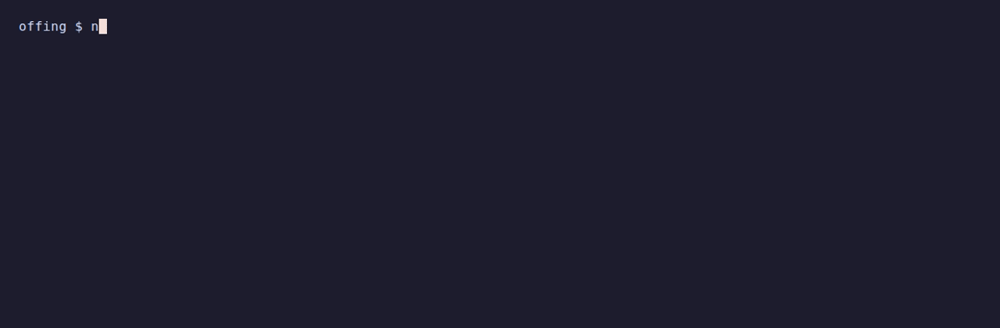

<p align="center"><picture><source media="(prefers-color-scheme: dark)" srcset="https://raw.githubusercontent.com/velella-sh/offing/main/.github/assets/mark-night.svg"></picture></p>
<h1 align="center">Offing</h1>
<p align="center"><strong>See what's in the offing. Fix it before it lands.</strong><br>Local-first end-of-life and deprecation scanner for your repository.</p>


<p align="center"><a href="https://github.com/velella-sh/offing/actions/workflows/ci.yml"></a>
  <a href="https://github.com/velella-sh/offing/actions/workflows/ci.yml"></a>
  <a href="https://www.npmjs.com/package/@velella/offing"></a>
  <a href="https://github.com/velella-sh/offing/blob/main/LICENSE"></a>
  <a href="https://github.com/velella-sh/offing/actions/workflows/ci.yml"></a>
  <a href="https://securityscorecards.dev/viewer/?uri=github.com/velella-sh/offing"></a>
  <a href="https://github.com/velella-sh/ebb"></a>
  <a href="https://skills.sh/velella-sh/offing/offing"></a></p>

Your scanner tells you what's vulnerable. Offing tells you what's ending.

Offing finds end-of-life and deprecated runtimes, packages, and GitHub Actions at the exact file and line, with sources and migration steps. It scans locally after installation. Coding agents can check a dependency before adding it through the CLI, MCP server, or Agent Skill.

## Quickstart

Run from your Git checkout with Node.js 22 or newer.

```bash
npx --yes @velella/offing scan .
npx --yes @velella/offing forecast .
npx --yes @velella/offing init --hooks --dry-run
```

The [quickstart guide](https://velella.sh/offing/QUICKSTART/) covers the first-run forecast, dependency checks, and adopting a baseline. The hook command previews the Git hook before you install it.

<p align="center">
  
</p>


The dependency guard stops a dry-run install of deprecated `request@2.88.2` before npm runs.

## Guides and evidence

- [Demo and terminal recordings](https://velella.sh/offing/DEMO/) for dependency checks, evidence, baselines, fix previews, forecasts, and agent setup.
- [Usage guide](https://velella.sh/offing/USAGE/) and [CLI reference](https://velella.sh/offing/CLI/) for migration packets, baselines, signed data updates, and the detector SDK.
- [Ecosystems](https://velella.sh/offing/ECOSYSTEMS/) and [compatibility matrix](https://velella.sh/offing/COMPATIBILITY/#ecosystem-coverage) for what Offing reads and reports.
- [Agent Skill](https://velella.sh/offing/AGENT_SKILLS/), [local MCP](https://velella.sh/offing/MCP/), [`llms.txt`](https://velella.sh/offing/llms.txt) and [`llms-full.txt`](https://velella.sh/offing/llms-full.txt).
- [GitHub Action (`velella-sh/offing@v0.1.1`)](https://velella.sh/offing/GITHUB_ACTION/), [versioned Action contract](https://velella.sh/offing/spec/action/v1/), and [onboarding App](https://velella.sh/offing/ONBOARDING_APP/).
- [Validation](https://velella.sh/offing/VALIDATION/), [roadmap](https://velella.sh/offing/ROADMAP/) and [architecture](https://velella.sh/offing/ARCHITECTURE/).

**Fix evaluation, November 28, 2026.** [50 of 60 pinned repositories were measured, and workflow validation stayed green in all 45 GitHub Actions fixer cases](https://github.com/velella-sh/offing/blob/main/benchmarks/fix-evals/results/2026-11-28/report.json). [See per-fixer and agent results](https://velella.sh/offing/fix-evals/).

**State of EOL 2027.** The study analyzed 1,000 of 1,000 pinned public GitHub repositories and found at least one runtime past end of life in 383 of the 1,000 successful scans. [Read the report, methodology, and evidence gaps](https://velella.sh/offing/reports/state-of-eol-2027/).

With Offing built from this checkout, run these commands from the repository you want to assess.

```sh
offing upgrade-check --to nodejs@22 . --graph
offing forecast . --target nodejs@22
```

The blocker graph groups recorded dependency paths by direct dependency. The target forecast compares current lifecycle deadlines with a proposed target and includes the migration blockers. [Upgrade blocker graph](https://velella.sh/offing/UPGRADE_CHECK/#group-blockers-by-direct-dependency) · [Target forecast](https://velella.sh/offing/WHAT_IF/)

## Fleet and campaigns

With Offing built from this checkout, scan an organization with
`offing fleet` and use a saved Fleet recording to plan the Node.js 18 to 22
example.

```sh
offing fleet example-org --json
offing campaign plan tests/fixtures/campaign-20/campaign.json --fleet tests/fixtures/campaign-20/fleet.json
```

[Campaign Board demo](https://velella.sh/offing/campaigns/demo/) · [Fleet guide](https://velella.sh/offing/FLEET/) · [Campaign walkthrough](https://velella.sh/offing/CAMPAIGNS/)

## Compare

| Tool | Comparison | Measurements |
| --- | --- | --- |
| Renovate | [Compare](https://velella.sh/offing/compare/renovate/) | [Results](https://velella.sh/offing/COMPARISON/#renovate) |
| Dependabot | [Compare](https://velella.sh/offing/compare/dependabot/) | [Results](https://velella.sh/offing/COMPARISON/#dependabot) |
| endoflife.date | [Compare](https://velella.sh/offing/compare/endoflife-date/) | [Results](https://velella.sh/offing/COMPARISON/#endoflifedate) |
| HeroDevs | [Compare](https://velella.sh/offing/compare/herodevs/) | [Results](https://velella.sh/offing/COMPARISON/#sbom-comparisons) |
| xeol | [Compare](https://velella.sh/offing/compare/xeol/) | [Historical results](https://velella.sh/offing/compare/xeol/#measured-evidence) |

[Comparison overview](https://velella.sh/offing/compare/) and [differential report](https://velella.sh/offing/differential-report/).
[Questions and issues](https://github.com/velella-sh/offing/issues) · [Security](https://github.com/velella-sh/offing/blob/main/SECURITY.md) · [Contributing](https://github.com/velella-sh/offing/blob/main/CONTRIBUTING.md)

## License and brand

Offing source code is licensed under the [Apache License 2.0](https://github.com/velella-sh/offing/blob/main/LICENSE). The lifecycle data it reads comes from [Ebb](https://github.com/velella-sh/ebb) (`@velella/ebb`): code under the [MIT License](https://github.com/velella-sh/ebb/blob/main/LICENSE), dataset under [CC BY 4.0](https://github.com/velella-sh/ebb/blob/main/LICENSE-DATA), attribution in [`ATTRIBUTION.md`](https://github.com/velella-sh/ebb/blob/main/ATTRIBUTION.md). The Offing name, logo, and files in [`brand/`](https://github.com/velella-sh/offing/tree/main/brand) are proprietary brand assets under separate [brand asset terms](https://github.com/velella-sh/offing/blob/main/brand/LICENSE.md).
