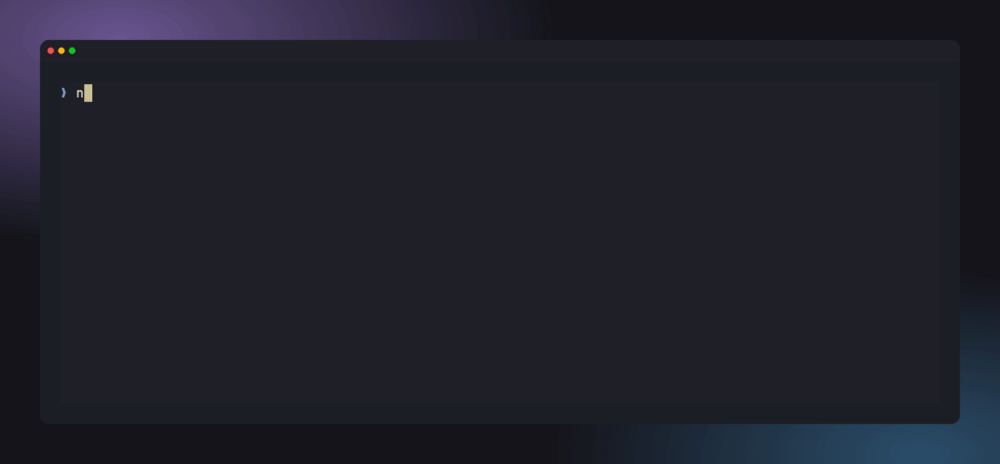

# Autopilot

`offing autopilot --dry-run` prints the first migration wave from `offing plan`,
the proposed setup, build and test commands, and the first agent prompt
preview. It scans the current files and starts no agent, test or Git process.

```sh
offing autopilot . --dry-run --to nodejs@22
offing autopilot . --dry-run --wave 1
offing autopilot . --dry-run --finding <finding-id>
```

Waves start at zero. Select one wave or one finding. `--to` accepts the same
runtime and version as `offing upgrade-check` and includes its verdict. The
preview uses the same [test plan](https://velella.sh/offing/TEST_RUNNERS/) as `offing doctor --tests`.
A nonempty `autopilot.tests` list replaces detected commands. `--agent` changes the driver named in the preview.

`offing autopilot . --prepare` requires a clean Git working tree and a commit.
It creates a temporary worktree from `HEAD` on a local `offing/autopilot/<run>`
branch and prints the path to its [run record](SCHEMAS.md#autopilot-run).
Use preparation to inspect the branch before you request test execution.

`offing autopilot . --prepare --replay /path/to/turns.json` applies a
trusted recording as data in the prepared checkout. The replay launches
no agent or repository commands. The default edit scope is the selected
migration packets’ files and tracked test files. GitHub workflows, dotenv
files, private keys, and lockfiles remain protected even with an explicit
allowlist. Replay refuses recorded secret text and records the stopping
guard in the run record.

A recording uses `offing.agent-replay.v1` with a `turns` array of
path-to-text objects. An optional `turnUsage` array supplies one object
with integer `turns`, `tokens` and `costCents` per recorded turn for
reproducing budget decisions. Older recordings count as one turn with
zero tokens and cost per edit object. An over-budget turn leaves the
previously accepted edits intact. A prepared replay still needs separate
test execution and verification.

## Run a recorded migration

```sh
npx @velella/offing@0.1.5 autopilot . --agent replay --run-replay /path/to/turns.json --wave 0
offing autopilot . --run-replay /path/to/turns.json --allow-red-baseline exact-test-name
```

Use a reviewed local checkout with Docker, an available pinned test image, and
a committed, explicitly approved `autopilot.tests` command. Offing runs that
command inside the container against the isolated baseline before making
edits. A red baseline stops the run. Repeat `--allow-red-baseline` for each
exact structured failure name you accept. A timeout, missing report, or
unlisted failure still stops the run.

Offing applies eligible codemods in their own local commit and writes an
`offing-verify-result.json` receipt when it makes that commit. It records the
remaining migration packets and bounded latest test feedback before each
recorded turn, then saves each nonempty accepted turn as its own numbered
commit. The recording supplies edited text; the prompts remain local evidence.
Success requires the selected lifecycle findings to clear without introducing
new findings and the approved tests to pass. Repeating the same net diff and
test failures stops the run. The live output shows the current phase, accepted turns, budget used and
latest test status. The summary identifies the local branch and counts
remaining or introduced findings for the wave. Inspect `final-verify-result.json`
for those findings. The run record, test results, turn summaries and prompts
live beside the isolated checkout shown in the command output.

The version-pinned example targets `0.1.5`. Before publication, use a CLI
built from the candidate source or installed from its npm tarball. The
[terminal tape](https://github.com/velella-sh/offing/blob/main/demos/autopilot.tape)
records the same verified replay against a disposable fixture, with no
model or credentials.



## Resume a stopped recording

When the run stops at `recording-exhausted`, pass a reviewed recording of
the **remaining** turns and the ID from the printed branch name:

```sh
offing autopilot . --resume <run> --run-replay /path/to/remaining-turns.json
```

Offing checks that the recorded checkout is clean and still at its expected
commit. It reuses the original wave, test approval and remaining budget.
It re-runs the approved tests on the preserved checkout and numbers each
accepted turn after the last recorded turn. The original evidence remains
available. The resumed verification goes to `resume-1-verify-result.json`
on the first continuation.

A guardrail stop, exhausted budget or altered checkout requires review.
A second continuation still uses the original run's cumulative usage.

## Undo a prepared worktree

```sh
offing autopilot . --undo <run>
```

Undo can infer the run when the repository has one prepared worktree. If it has
several, pass the ID from the branch name. Undo refuses an advanced branch or
a worktree containing local changes or recorded migration evidence. It
removes the prepared worktree, branch and run record. For an advanced
replay, save the commits and evidence you want to keep first. Run
`git worktree remove "<isolated-checkout>"` from the original repository
and use `git branch -D <autopilot-branch>` only when you intend to discard
the local branch.
