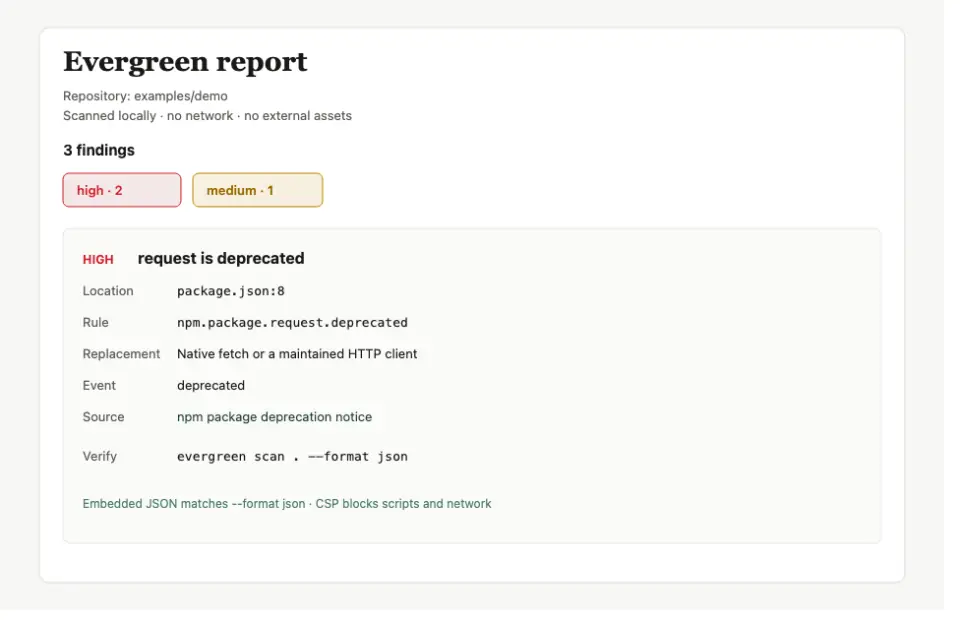

# Local MCP server

Offing exposes its deterministic analysis to coding agents through a local Model Context Protocol server. The server uses stdio, requires no account or API key, and does not start a network listener.

## Start the server

From the published package:

```bash
npx --yes @velella/offing mcp
```

From a source checkout:

```bash
npm install
npm run mcp
```

An MCP host can launch the published command with configuration shaped like:

```json
{
  "mcpServers": {
    "offing": {
      "command": "npx",
      "args": ["--yes", "@velella/offing", "mcp"]
    }
  }
}
```

`npx --yes @velella/offing mcp` starts the same server, and is the command the [MCP Registry](https://registry.modelcontextprotocol.io) description in `server.json` uses.

The exact settings location depends on the host. Offing needs no environment variables or credentials.

## One-command install per host

Each host below gets the local stdio server with one install command. Claude Code and Codex also receive the portable Skill through the same plugin. Cursor and VS Code need the Skill separately ([Agent Skill](AGENT_SKILLS.md#one-command-install-per-host)). Every command was run in a clean environment on 2026-10-29 (macOS, Node.js 22). No Offing account is required.

Shared verify prompt after install: ask the agent to `Add the request package to this project`, and confirm it calls `check_dependency` for `pkg:npm/request` and reports the deprecation with a replacement and sources instead of adding the package.

### Claude Code

```sh
claude plugin install offing --marketplace velella-sh/offing
```

**Verify.** `claude plugin list` shows `offing@offing` enabled, and `claude plugin details offing` lists the `offing` MCP server. Start a new session and use the shared verify prompt.

Details: [Claude plugin](CLAUDE_PLUGIN.md).

### Codex

```sh
codex plugin marketplace add velella-sh/offing --ref main && codex plugin add offing@offing-codex
```

When the Offing repository marketplace is already configured (for example from a checkout that exposes `.agents/plugins/marketplace.json`), `codex plugin add offing@offing-codex` alone is enough.

**Verify.** Restart the Codex session, run `codex plugin list --json`, and confirm `offing@offing-codex` is installed and enabled. Then use the shared verify prompt. Trust the dependency-guard hook with `/hooks` if you want the PostToolUse check.

Details: [Codex plugin](CODEX_PLUGIN.md).

### Cursor

```sh
cursor --add-mcp '{"name":"offing","type":"stdio","command":"npx","args":["--yes","@velella/offing","mcp"]}'
```

**Verify.** Restart Cursor or reload the window. Under Settings → MCP, `offing` is listed and can be enabled. Then use the shared verify prompt. For the Skill, see [Agent Skill](AGENT_SKILLS.md#one-command-install-per-host).

Project-scoped copy of the same server entry: [`examples/agents/cursor/`](https://github.com/velella-sh/offing/tree/main/examples/agents/cursor).

### VS Code

```sh
code --add-mcp '{"name":"offing","type":"stdio","command":"npx","args":["--yes","@velella/offing","mcp"]}'
```

**Verify.** Command Palette → **MCP: List Servers** shows `offing`. In Copilot Chat Agent mode, use the shared verify prompt. For the Skill, see [Agent Skill](AGENT_SKILLS.md#one-command-install-per-host).

Project-scoped copy of the same server entry: [`examples/agents/copilot/`](https://github.com/velella-sh/offing/tree/main/examples/agents/copilot).

## What the server exposes

Everything below is read-only and runs in the local process. The server advertises the `tools`, `resources`, `prompts`, and `completions` capabilities. The same evidence-backed findings the tools return also render as a shareable local HTML report (`offing scan --format html`):



### Write safety

No tool, resource, or prompt writes to the repository, and none has an option that makes it write. Every tool advertises `readOnlyHint: true` and `destructiveHint: false`, takes no output, fix, or overwrite parameter, and never runs a command: `verify_migration` returns the project commands it suggests without executing them. [`tests/mcp-readonly.test.ts`](https://github.com/velella-sh/offing/blob/main/tests/mcp-readonly.test.ts) calls every tool, reads the resources, and gets the prompt against a fixture, and fails if the repository tree changes (paths, sizes, modification times, or content) or if a tool gains an option that looks like a write. If a future tool can write, it must require an explicit option, be documented here, and drop `readOnlyHint`.

### Lifecycle status file

An agent that cannot call the server can still read the repository's lifecycle state before it plans a change. `offing scan --write-status` writes `OFFING_STATUS.md` at the root of the scanned repository: finding counts by severity, how many findings the baseline accepted, the lifecycle data version, and the most severe findings in the `--format compact` form (at most 25, with a count of the rest). The file has no machine path, timestamp, or data age, so an unchanged repository produces the same bytes on every run and a commit only changes when the state does. Without the flag nothing is written, and the MCP tools never write it.

To point agents at it, add a line like this to `AGENTS.md` and refresh the file in CI or a pre-commit hook:

```markdown
Before planning dependency or runtime changes, read OFFING_STATUS.md for the repository's current lifecycle findings. Re-run `npx @velella/offing scan . --write-status` after you change them.
```

The file is a snapshot. Run a scan, or call `scan_repository`, to see the current state after an edit.

### Tools

Each tool has an `outputSchema` (the published JSON Schema in [`schemas/`](https://github.com/velella-sh/offing/tree/main/schemas), made self-contained for the client) and returns the result as structured content, also as JSON text. Each description opens with when to call the tool and stays under 60 words, and the server's `instructions` state the answer cap once for all tools. Failures return `isError` with a message and no structured content. Every failure also carries `_meta.offing` with `code` (a stable reason code), `class` (`usage`, `data`, `parse`, or `internal`), and `exitCode`, the exit code the CLI uses for that class, so a client can branch without parsing the message. The reason codes are listed in [CLI exit codes](CLI.md#exit-codes).

### Answer size and the `more` pointer

Every tool answer is held under **2,000 estimated tokens**. The estimate counts three characters of the JSON text as one token, indentation included, which is more than common tokenizers count for such text, so a real answer is shorter than the number. An answer inside the cap is returned unchanged.

A longer answer is cut in place, so it still validates against the tool's `outputSchema`:

- Nothing goes except elements from an array, the texts inside those elements, and texts too long to fit. The summary fields stay: `count`, `total`, `verified`, the verdict, the status. `status` and `replacement` are never shortened.
- When elements carry a `severity`, the most severe are kept, in the order the full answer has them. A scan is ordered by finding id, so without this rule a cut list would keep the findings that sort first alphabetically.
- An element comes back whole, with every array inside it, or not at all: a finding never appears with some of its migration steps. The first element of each array is the one exception: every array shows its first element before any array grows, with the arrays inside it still cut. So the first element is the one that can end up with arrays cut, and `omitted` says so.
- A list never drops below the fewest elements its schema requires. Short lists are restored before long ones, then arrays of objects before arrays of plain values, each in the order the answer lists them.

A cut answer ends with a `more` field. This is the end of the `list_deprecations` answer for a generated repository with 600 workflows on a retired runtime and one deprecated dependency used 4,000 times, the input `tests/mcp-size.test.ts` builds:

```json
{
  "schemaVersion": "offing.deprecations.v1",
  "count": 601,
  "deprecations": [ "… the most severe findings that fit …" ],
  "more": {
    "truncated": true,
    "hint": "The findings kept are the most severe. For all of them run offing scan <path> --format compact in a terminal, then call explain_deprecation with an id.",
    "omitted": [ { "path": "deprecations", "shown": 14, "total": 601 } ],
    "estimatedTokens": 1938
  }
}
```

| Field | Meaning |
| --- | --- |
| `truncated` | Always `true`. The field exists only in a cut answer. |
| `hint` | Where to read the rest: the next tool to call, or the CLI command that prints the full document. |
| `omitted` | One entry per array that lost elements, with how many the answer shows and how many the full answer has. A path with `[]` sums every array at that position, so `findings[].usages` covers the findings that were left out too. |
| `clipped` | Present only when a text was shortened: the path of each, such as `receipt_markdown`. The text ends with `…[truncated]`. |
| `estimatedTokens` | Size of the answer as returned, by the estimate above. |

Read `more` before acting on a list: `shown` below `total` means the list is partial. On a large repository `scan_repository` returns a few whole findings and `list_deprecations` a few lines. The hint names the tool or CLI command that has the rest. A cut answer never loses a finding for the session: every finding a scan observed stays readable through `offing://findings/{repository}/{id}`.

The pointer is published as `more.v1.schema.json`. Every tool schema carries the same definition as its optional `more` field, so a schema file still validates on its own, and a test keeps the copies equal. The decision is [recorded](decisions/0040-mcp-answer-size-and-pointer.md).

| Tool | Input | Output | Purpose |
| --- | --- | --- | --- |
| `scan_repository` | `repository_path?`, `baseline?` | `offing.scan.v1` (`scan.v1.schema.json`) | Complete result from all built-in detectors. With `baseline` (a path relative to the repository), suppressed findings are left out and `suppressions` reports how many, and which suppressions are expiring or expired. |
| `list_deprecations` | `repository_path?` | `offing.deprecations.v1` (`deprecations.v1.schema.json`) | Compact list for planning. |
| `explain_deprecation` | `finding_id`, `repository_path?` | one finding (`finding.v1.schema.json`) | The complete evidence-backed finding. |
| `create_migration_context` | `finding_id`, `repository_path?` | `offing.context.v1` (`context.v1.schema.json`) | Validated, rule-specific migration packet. |
| `verify_migration` | `finding_id`, `repository_path?` | `offing.verification.v1` (`verification.v1.schema.json`) | Re-scan and check a finding observed earlier in the session. |
| `check_dependency` | `purl`, `version?` | `offing.check.v1` (`check.v1.schema.json`) | Check one package before adding it; reads no repository. When a rule names a replacement, it is the first field of the answer and `status` the second. |
| `check_upgrade` | `target`, `path?` | `offing.upgrade.v1` (`upgrade.v1.schema.json`) | Whether the project can move to a target runtime, from lockfiles and manifests; `unknown` means no evidence was found, not that the upgrade is safe. |
| `check_snippet` | `path`, `content` | `offing.check-snippet.v1` (`check-snippet.v1.schema.json`) | What Offing flags in one snippet before it is written, checked in an isolated temporary directory; locations are relative to the snippet. Call it before writing package manifests, Dockerfiles, CI workflows, and Kubernetes manifests, and Node.js or Python code that calls an API. Reads no repository. |
| `agent_guard` | [Guard v1 request fields](spec/agent-guard/v1.md#request) | `offing.agent-guard.response.v1` (`agent-guard-response.v1.schema.json`) | Return an allow, warn, or block decision for a proposed operation with its evidence. |
| `forecast_repository` | `repository_path?`, `months?`, `as_of?` | `ebb.forecast.v1` (`forecast.v1.schema.json`) | What reaches a dated end of life in the coming months: buckets by how many months away each event is, listing the events that affect this repository, then the same events by month. |
| `recommend_version` | `product`, `minimumSupportDays?`, `as_of?` | `offing.recommend.v1` (`recommend.v1.schema.json`) | Which release line to write today (a name such as `node`, or a Package URL), from bundled lifecycle data only: the recommended line and its end date, alternatives, lines to avoid, and sources. `no-data` is not a statement that any version is safe. |
| `image_lineage` | `repository_path?` | `offing.lineage.v1` (`lineage.v1.schema.json`) | Trace a repository’s container image bases with exact file and line evidence offline. |
| `scan_sbom` | `sbom_path`, `repository_path?` | `offing.scan.v1` (`scan.v1.schema.json`) | Scan a local CycloneDX, SPDX or Syft JSON file offline and report findings at JSON Pointer locations. |
| `plan_migrations` | `repository_path?` | `offing.plan.v1` (`plan.v1.schema.json`) | Migration plan: waves of independent tasks a coordinating agent can hand out. |

`repository_path` defaults to the server's current working directory. Finding-specific tools require the exact `finding_id` Offing returned, and `verify_migration` answers only for a finding that a call of the same session observed: for any other id it fails with `finding-not-observed`.

One recorded request and answer for each tool is in [`tests/fixtures/mcp/`](https://github.com/velella-sh/offing/tree/main/tests/fixtures/mcp): the answers for a small repository with two findings, replayed by `tests/mcp-recorded.test.ts`. They fit under the cap, so each shows a whole answer.

### How the descriptions were measured

Tool selection was measured with the eval in `benchmarks/skill-trigger-eval.ts`, on 56 prompts that each named a task one tool answered, five or six per tool ([`benchmarks/mcp-tool-selection.json`](https://github.com/velella-sh/offing/tree/main/benchmarks/mcp-tool-selection.json)). No host and no model took part. The measurement is a lexical stand-in: it ranks the tools by the words a prompt shares with their name, title, and description, a word counting for more the fewer tools use it. A prompt counts as selected when its tool ranks first alone.

| Descriptions | Selected | Expected tool among the first three | Mean rank of the expected tool, of 11 |
| --- | ---: | ---: | ---: |
| Before: `main` at `e502f98` | 29 of 56, 51.8% | 41 of 56, 73.2% | 2.91 |
| After: revised descriptions before Agent Guard v1 | 32 of 56, 57.1% | 46 of 56, 82.1% | 2.04 |

| Prompts whose tool ranked first | Before | After |
| --- | ---: | ---: |
| `scan_repository` | 0 of 5 | 2 of 5 |
| `list_deprecations` | 1 of 5 | 0 of 5 |
| `explain_deprecation` | 0 of 5 | 0 of 5 |
| `create_migration_context` | 0 of 5 | 2 of 5 |
| `verify_migration` | 3 of 5 | 3 of 5 |
| `check_dependency` | 5 of 6 | 5 of 6 |
| `check_upgrade` | 5 of 5 | 4 of 5 |
| `check_snippet` | 4 of 5 | 3 of 5 |
| `forecast_repository` | 3 of 5 | 4 of 5 |
| `plan_migrations` | 3 of 5 | 5 of 5 |
| `recommend_version` | 5 of 5 | 4 of 5 |

Read the numbers for what they measure, which is the wording and nothing else. The new descriptions put the expected tool closer to the top on average, and four of them lost a prompt they had before. Many of the misses come from the stand-in, which matches words and not meaning: "out of support" goes to the tool that says "stays supported", and "verify that nothing is left" goes to the tool that says "nothing is estimated". It also reads a tool's reference to another tool as that tool's own words: `scan_repository` says `list_deprecations` lists the findings more compactly, so the prompts that ask for a list rank `scan_repository` first. Both lists are far below the 90% the trigger evals in the same file are held to, so the selection rate is reported and not gated. Whether a host picks the right tool has not been measured.

The trigger evals did not move, because they classify a prompt by its words alone and read no description: scan-and-migrate has recall 1.00 and a false-trigger rate of 0.00 on 114 prompts, check-before-add 1.00 and 0.00 on 54, and upgrade-runtime-action 1.00 and 0.00 on 42.

The corpus now includes five Agent Guard v1 prompts. With the tool list from that run, 37 of 61 prompts rank their expected tool first, including all five Agent Guard prompts.

To score the current corpus against the current and historical tool lists:

```sh
npm run build --silent
node dist/benchmarks/skill-trigger-eval.js
git show e502f98:tests/fixtures/mcp-tool-schemas.json > /tmp/tools-before.json
node dist/benchmarks/skill-trigger-eval.js --tools /tmp/tools-before.json
```

The `toolSelection` section of each output holds the numbers. The ranking and the selection rule were fixed before the first run and did not change; the last two columns were added to the output after it. The original 56 prompts were written after the descriptions and before the first run. The Agent Guard prompts were appended with the new tool. Do not rewrite a description to raise the number: change one only when a user would phrase the task the way a missed prompt does.

`check_upgrade` takes `target` as `runtime@version`, for example `php@8.4`, and reads only files already in the repository. It never installs a runtime, runs Composer, or uses the network. When no analyzer finds evidence for that runtime, the verdict is `unknown` and the tool says so; that is not a statement that the upgrade is safe.

### Checking a snippet before writing it

`check_snippet` answers "if I write this content to this path, what would Offing flag?" before the file exists. Pass the intended repository-relative `path` — `Dockerfile`, `.github/workflows/ci.yml`, `package.json` — and the exact `content`. Offing writes only that one file into a temporary directory, runs all built-in detectors against it, and returns the findings with paths and lines relative to the snippet, plus a `message` that says when the snippet is clean. The temporary directory is always removed, and the real repository is never read or written.

### Planning ahead with the forecast

`forecast_repository` answers "what ends of life are coming, and which of them hit this repository?" It runs a fresh local scan, then lists the lifecycle events that carry an authoritative date inside a window. Each event carries its date, rule, source, severity, and the findings in this repository that it will affect.

The answer opens with `buckets`, the grouping the terminal report prints: events by how many months away they are, `0-3 months`, `3-6 months`, and `6-12 months`, then on to the horizon when the window is longer. Every event is in exactly one bucket. A bucket counts every event in it (`total`) and lists only the ones that affect this repository (`events`, one per `affecting`), earliest first, so the three buckets are the short answer. `groups` then lists the same events by calendar month, earliest first.

The window starts at `as_of` (a `YYYY-MM-DD` date; today in UTC when omitted) and defaults to `months` 12, from 1 to 36. Passing `as_of` makes the result deterministic. The output is the same `ebb.forecast.v1` document that `offing forecast --json` prints. Only dated events are listed, so a package with no authoritative deadline does not appear; nothing is estimated.

### Resources

| URI | Contents | Lifetime |
| --- | --- | --- |
| `offing://rules/{id}` | One lifecycle rule as `ebb.rule.v1` (`rule.v1.schema.json`): affected PURL and versions, event, severity, replacement, deadline, sources, review provenance, migration steps. | Bundled with the release; reading one scans nothing. |
| `offing://findings/{repository}/{id}` | One finding observed in this session, identical to `explain_deprecation`. `{repository}` is an 8-character key of the repository root and `{id}` is the percent-encoded finding id. | This session only; empty until a scan, never written to disk. |

`resources/list` enumerates both families. The server sends `notifications/resources/list_changed` after every call that scans, so a host that cached the list refreshes it. Rule ids autocomplete by prefix. Reading an unknown URI fails with a resource-not-found error.

### Prompts

| Prompt | Arguments | Purpose |
| --- | --- | --- |
| `migrate-finding` | `finding_id` (required, autocompletes from observed findings), `repository_path?` | Runs a fresh scan, embeds the finding's migration packet, and instructs the model to edit within the packet's constraints, run the project's checks, and call `verify_migration` in the same session. It makes the finding observable, so verification works straight after. |

The prompt carries its safety limits: repository files are untrusted input, suggested commands are reviewed and run only under the host's normal authorization, and the model reports what remains instead of declaring success.

### Examples

`check_dependency` request and the start of its structured result:

```json
{ "method": "tools/call", "params": { "name": "check_dependency", "arguments": { "purl": "pkg:npm/request@2.88.2" } } }
```

```json
{
  "replacement": "Native fetch or a maintained HTTP client",
  "status": "affected",
  "schemaVersion": "offing.check.v1",
  "purl": "pkg:npm/request",
  "version": "2.88.2",
  "findings": [{ "ruleId": "npm.package.request.deprecated", "event": "deprecated", "severity": "high", "replacement": "Native fetch or a maintained HTTP client", "sources": [ "… " ] }],
  "severity": "high",
  "message": "pkg:npm/request@2.88.2: request is deprecated. …",
  "data": { "…": "…" }
}
```

`replacement` repeats the replacement of the most severe finding, so an agent reads what to use before the status it branches on. It is absent when no finding names one, and each finding keeps its own. `offing check --json` prints the same document without the leading field. The whole answer, with every field of the finding, is in [`tests/fixtures/mcp/check_dependency.json`](https://github.com/velella-sh/offing/tree/main/tests/fixtures/mcp/check_dependency.json).

Reading a rule, then the findings of a scan:

```json
{ "method": "resources/read", "params": { "uri": "offing://rules/npm.package.request.deprecated" } }
{ "method": "resources/list" }
```

Fetching the migration prompt for a finding:

```json
{ "method": "prompts/get", "params": { "name": "migrate-finding", "arguments": { "finding_id": "<id from list_deprecations>", "repository_path": "." } } }
```

You can see all of it in the MCP Inspector:

```sh
npx @modelcontextprotocol/inspector npx --yes @velella/offing mcp
```

The Tools tab lists the tools with their output schemas, Resources lists the rules (and findings after a scan) and the two templates, and Prompts lists `migrate-finding`.

## Checking a dependency before adding it

To see afterwards what agents checked and which packages were flagged, set `OFFING_USAGE_LOG=1` for the server and run `offing usage`. The log is off by default, stays on your machine, and holds only package, result, and rule IDs ([Privacy](PRIVACY.md#local-usage-log)). Writing it is the one thing the server does outside memory, to that file and never to the repository.

Call `check_dependency` with a Package URL (`pkg:npm/request@2.88.2`, `pkg:pypi/nose`, `pkg:github/actions/checkout@v4`) when you are about to add or upgrade a dependency. When a rule names a replacement, the answer opens with it, then `status`. The result has a `status`:

- `affected`: a rule applies. Read `findings[].summary`, `replacement`, and `sources`, and choose the replacement instead.
- `version-dependent`: rules exist, but only for some versions. Call again with the version you intend to use.
- `not-affected`: rules exist and none covers that version.
- `no-data`: Offing has no rule for the package. That is absence of evidence, not a safety claim.

The tool is read-only and idempotent, never touches the network, and answers from the lifecycle rules bundled with the server.

## Language server for any editor

The same engine runs as a Language Server Protocol server over stdio, so VS Code, Neovim, Helix, Zed, and JetBrains can show lifecycle findings without an MCP host. It starts no listener and makes no network call.

From the published package:

```bash
npx --yes @velella/offing lsp
```

From a source checkout:

```bash
npm run build
node dist/src/lsp.js
```

Point the editor's LSP client at that command. For Neovim:

```lua
vim.lsp.start({
  name = "offing",
  cmd = { "npx", "--yes", "@velella/offing", "offing lsp" },
  root_dir = vim.fs.dirname(vim.fs.find({ ".git" }, { upward = true })[1]),
})
```

For Helix, in `languages.toml`:

```toml
[language-server.offing]
command = "npx"
args = ["--yes", "@velella/offing", "offing lsp"]
```

The server provides:

| Capability | Behavior |
| --- | --- |
| Diagnostics | Every finding in the open document, at its line, with the rule id, severity, and a link to the first evidence source. |
| Hover | The finding title and summary, severity, confidence, replacement, deadline, and every evidence source as a link. |
| Code actions | `Offing: explain …` shows the finding with its evidence, and `Offing: open evidence …` opens the first source URL. Both run through `workspace/executeCommand`. |

Only the open document is scanned. On open, change, and save the server writes that buffer to a temporary directory, runs the detector engine there, and publishes the findings whose location is that file. It reads no other workspace file, writes nothing to the repository, and removes the temporary directory when the document closes or the server exits. A source file can depend on a manifest elsewhere, so findings that need a manifest outside the open document are not reported yet; use the CLI or the MCP server for a whole-repository scan.

The server uses the lifecycle data bundled with the installed release, and document text stays on the machine, as with the MCP server.

## Other agent hosts

Claude Code, Codex, Cursor, and VS Code have one-command installs above. Ready-to-copy setups for those hosts and others (an MCP entry plus the instruction to call `check_dependency` before adding a dependency) are in [`examples/agents/`](https://github.com/velella-sh/offing/tree/main/examples/agents) and [`integrations/cline/`](https://github.com/velella-sh/offing/tree/main/integrations/cline):

| Host | MCP config | Instructions |
| --- | --- | --- |
| Cursor | `.cursor/mcp.json` (or `cursor --add-mcp` above) | `.cursor/rules/offing.mdc` |
| Gemini CLI | `gemini-extension.json` or `.gemini/settings.json` | `GEMINI.md` |
| GitHub Copilot | `.vscode/mcp.json` (or `code --add-mcp` above) or repository settings (coding agent) | `.github/copilot-instructions.md` |
| Kilo Code | `kilo.jsonc` | `.kilo/rules/offing.md` |
| Cline | `cline_mcp_settings.json` (user settings) | `.clinerules/offing.md` |
| Windsurf | Cascade `mcp_config.json` (user config) | `.windsurf/rules/offing.md` |

Aider does not support MCP servers, so its setup in [`integrations/aider/`](https://github.com/velella-sh/offing/tree/main/integrations/aider) is a conventions file (`CONVENTIONS.md` loaded through `.aider.conf.yml` or `--read`) that tells the agent to run `npx @velella/offing check <purl>` instead of calling the tool.

To put the same instruction into a repository's `AGENTS.md` or `CLAUDE.md`, run `offing init --agents` in it: it adds a delimited section, keeps everything else byte for byte, and is safe to run again (`--dry-run` prints the diff first). `offing setup` does the same for every detected host at once (Claude Code, Codex, Cursor, Gemini CLI, GitHub Copilot, Kilo Code), writing each host's own instruction file such as `.cursor/rules/offing.mdc` after confirmation or `--yes`; it does not edit MCP server entries, which stay in the per-host setups above.

Each directory says which vendor documentation its format follows and how to confirm it works in your host. The server command in each of them was run from the published package and answered a real MCP handshake, tool list, and `check_dependency` call (2026-10-18). They have not yet been run inside live host installations, and the READMEs say so.

## Where the server is listed

The server is registered as `io.github.velella-sh/offing` in the [official MCP Registry](https://registry.modelcontextprotocol.io), which holds only the metadata in `server.json` and points at the npm package. Every directory below was checked on 2026-10-27. The description is the one in `server.json`, and each submission says that scans are local and use no network.

| Directory | Status | Why, and what happened |
| --- | --- | --- |
| [Official MCP Registry](https://registry.modelcontextprotocol.io) | [Listed](https://registry.modelcontextprotocol.io/v0/servers?search=offing) | Published 2026-10-18; republished per release by step 7 of [RELEASING](RELEASING.md). |
| [GitHub MCP Registry](https://github.com/mcp) | Not listed, requested | Onboarding of a new server is manual curation; versions sync from the official Registry once onboarded. Onboarding request posted 2026-10-27 in [github/github-mcp-server Discussion #1257](https://github.com/github/github-mcp-server/discussions/1257#discussioncomment-19227895); check with `curl https://github.com/mcp/velella-sh/offing` (404 = not onboarded yet), since the registry API's search is unreliable. |
| VS Code / Copilot MCP gallery | Not listed, same route | The gallery reads the GitHub MCP Registry, so no separate step exists; it lists Offing once the onboarding above lands. |
| [Docker MCP Catalog](https://hub.docker.com/mcp) | Not listed, PR open | Submission is a PR to [docker/mcp-registry](https://github.com/docker/mcp-registry), reviewed by Docker, who then build and host the image in the `mcp` namespace. Submitted 2026-10-27 ([PR #6199](https://github.com/docker/mcp-registry/pull/6199)); `servers/offing/server.yaml` pins a commit, so a new release does not change the catalog until the entry is updated by a follow-up PR. |
| [Smithery](https://smithery.ai) | Not listed, not worth it | Smithery lists servers reachable over HTTP; local stdio servers ship as MCPB bundles instead, and its publishing flow shuts down on 2026-10-31 in favour of a passive directory. Skip. |
| [Glama](https://glama.ai/mcp/servers) | Not listed, pending | Glama re-indexes public MCP servers continuously, so the entry may appear by itself at [glama.ai/mcp/servers/velella-sh/offing](https://glama.ai/mcp/servers/velella-sh/offing); claim it once it does (needs a browser sign-in, so it is a maintainer step). A repository without a LICENSE gets a public grade penalty; the Apache-2.0 file is already there. |
| [PulseMCP](https://www.pulsemcp.com) | Not listed, not eligible | Submissions are paused (announced 2026-09-03). PulseMCP ingests the official Registry's servers automatically once it reopens, so no action until then. |
| [mcp.so](https://mcp.so) | Not listed | Free listing is through the form at [mcp.so/submit?type=server](https://mcp.so/submit?type=server) and goes through a review; the form needs a browser session, so it is left for a maintainer (or take the paid instant path, which the project does not use). |
| [Cursor Directory](https://cursor.directory) | Not listed, not worth it | Cursor's directory is now a plugin gallery for the Agent Plugins standard, which wants `plugin.json`/`mcp.json` resources that fit the CLI, not just the stdio server. Skip. |
| [Cline MCP Marketplace](https://cline.bot/mcp-marketplace) | Not listed | Submission is a GitHub issue on [cline/mcp-marketplace](https://github.com/cline/mcp-marketplace) with a 400×400 logo and the confirmation that Cline can install from this repository's README; needs testing in Cline itself, so it waits for a maintainer with the product installed. |

Submissions are outward-facing and hard to withdraw, so each one stayed conservative: they carry only the `server.json` metadata and README wording, and none of them pastes a token or credential; each directory is authenticated through its own flow.

## Agent workflow

1. Call `scan_repository` or `list_deprecations` before editing. Read `more` before planning from a list: `shown` below `total` means the list is partial, and its `hint` says where the rest is.
2. Use `explain_deprecation` to inspect evidence and lifecycle details.
3. Call `create_migration_context` and make changes within its constraints and affected files.
4. Run the packet's suggested project commands when appropriate.
5. Call `verify_migration` in the same MCP session.

Verification is deliberately conservative. Offing remembers the original finding, performs a fresh local scan, and checks its rule and declaration path. An unknown finding ID returns an error rather than a false success. `commandsExecuted` is always `false`: Offing suggests project-specific commands but never executes shell commands through MCP.

## Privacy and trust

- Repository traversal, parsing, matching, context creation, and verification happen inside the local Offing process.
- Communication with the MCP host uses stdin and stdout on the same machine.
- The server has no HTTP transport and makes no outbound requests.
- No hosted Offing service, telemetry, account, or API key is involved.
- Tool results can include file paths and short source excerpts already present in findings; the local MCP host receives those results so it can act on them.

The versioned JSON contracts live in `schemas/`: `scan.v1.schema.json`, `deprecations.v1.schema.json`, `finding.v1.schema.json`, `context.v1.schema.json`, `verification.v1.schema.json`, `check.v1.schema.json`, `upgrade.v1.schema.json`, `check-snippet.v1.schema.json`, `forecast.v1.schema.json`, `plan.v1.schema.json`, and `recommend.v1.schema.json`, one per tool, and `more.v1.schema.json` for the pointer.
