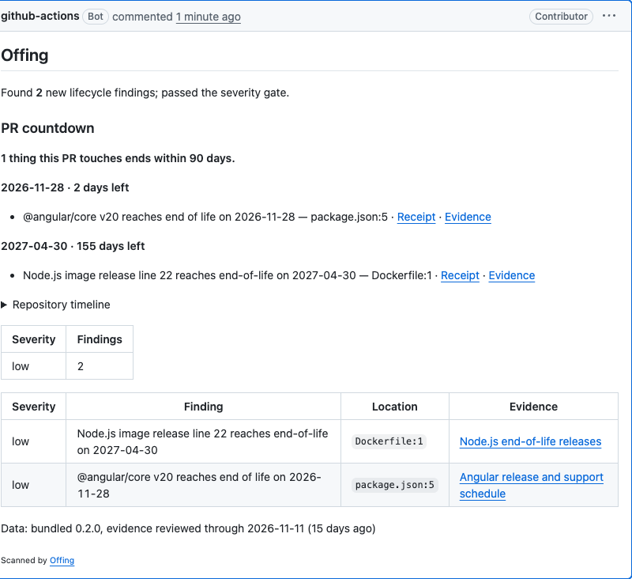

# Pull request countdown

Set `pr-comment: "true"` in the [Offing GitHub Action](GITHUB_ACTION.md) on a `pull_request` workflow. Check out the pull request with `fetch-depth: 0` so Offing can compare the head with its base. Give same-repository runs `pull-requests: write` to let Offing create or update one comment. Fork runs with a read-only token get the same report under the run's **Summary** tab.

The countdown shows dated findings on added or edited lines. It gives the number due in the next 90 days, groups entries by UTC deadline, and shows days left or days since the deadline passed. Expand **Repository timeline** for the broader twelve-month view. The severity counts, findings, and gate status follow the countdown.

**Evidence** opens the source for the deadline. **Receipt** opens the run's artifacts, where `offing-pr-receipt` contains the JSON [verification receipt](RECEIPTS.md) comparing the Git trees before and after the change. Use the file and line to find the corresponding finding. Large comments cap displayed rows and report how many were omitted. Set `upload-report: "true"` to keep the full scan report with the run.

## Example from GitHub

Offing posted this comment on PR #1052 and updated the same comment on the second attempt. [GitHub comment](https://github.com/velella-sh/offing/pull/1052#issuecomment-7204194757)

## Release acceptance evidence

The `acc-pr-countdown` job ran the packaged Action with `pr-comment: "true"` from a sparse checkout containing only the consumer fixture. It checked the dated findings and the generated receipt. The packaged candidate for `0.1.2` reports source package version `0.1.1` and was pinned to commit `211a1f7b3a490dc3b8e35e6ad69f4778020741ce`. [Passing workflow and artifacts](https://github.com/velella-sh/offing/actions/runs/45901394013)
