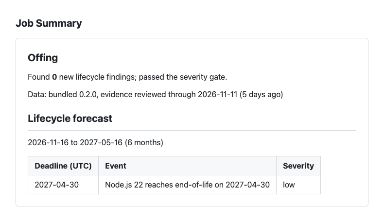

# Lifecycle forecast in GitHub Actions

Enable the forecast to see dated lifecycle events in the Actions Job Summary, an Offing comment on the pull request,
and a downloadable calendar. The [example workflow](https://github.com/velella-sh/offing/blob/main/examples/workflows/forecast.yml)
uses Offing v0.2.0 once that release is published.

| Input | Default | Effect |
| --- | --- | --- |
| `forecast` | `false` | Set to `"true"` to publish the forecast. |
| `forecast-months` | `6` | Forecast window in months from the current UTC date. Accepts whole numbers from 1 to 36 when the forecast is enabled. |

On a `pull_request` run, Offing scans the exact base and head commits. The forecast shows only deadlines that start
affecting the repository or move earlier in the selected window. Use `fetch-depth: 0` to make both commits available;
if either commit is unavailable, Offing logs a warning and skips the forecast. Outside pull requests, the forecast
lists dated events affecting the checkout. Forecasts use the repository at `path` as their starting point, cover the
whole repository for pull requests, and use raw scan results independently of the gate and baseline.

## Permissions and forks

Use `contents: read` for checkout and `pull-requests: write` for the comment. Offing uses the workflow's `github.token`.
The first run creates one comment and later runs update it. If `pr-comment` is also enabled, the findings and forecast
share that comment. Use one forecast job per pull request with a per-PR concurrency group, as in the example,
so overlapping runs cannot both try to create the first comment.

On pull requests from forks, Offing skips the comment and logs the reason. The Job Summary and calendar are still
published. The example uses the `pull_request` trigger and runs without custom secrets.

## Download the calendar

Open the workflow run and download the `offing-forecast` artifact from **Artifacts**. Unzip it and import
`offing-forecast.ics` into your calendar. Its dated events match the forecast shown in the Job Summary. If the file
cannot be written, Offing logs a warning and keeps the summary and the comment available.
