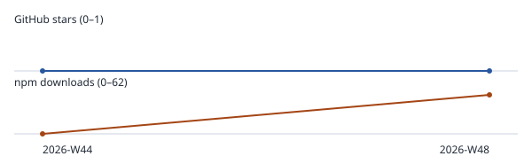

# Launch metrics

Offing's weekly snapshots use public, aggregate data. Collection runs in this repository's maintainer workflow. See the [privacy-first adoption decision](../docs/decisions/0019-privacy-first-adoption-metrics.md).

| Field | Public source | Measurement window |
| --- | --- | --- |
| `github.stars`, `github.forks` | [GitHub repository API](https://api.github.com/repos/velella-sh/offing) | Repository totals on the recorded UTC date |
| `npm.downloads` | [npm downloads API](https://api.npmjs.org/downloads/point/last-week/@velella/offing) | Rolling seven days, with the inclusive UTC dates reported by npm in `npm.start` and `npm.end` |
| `listings.officialRegistry` | [Official MCP Registry API](https://registry.modelcontextprotocol.io/v0.1/servers/io.github.velella-sh%2Foffing/versions/latest) | One if the latest entry for Offing is active on the recorded UTC date, zero if absent or inactive |

Directories without an anonymous public source for an Offing listing count are omitted. The chart uses separate scales for GitHub stars and npm downloads. Point spacing follows the ISO week calendar.

The [2026-W44 snapshot](2026-W44.json) uses the [2026-10-28 adoption snapshot](adoption/2026-10-28.json) for GitHub totals and registry presence, plus the [npm API for 2026-10-21 through 2026-10-27](https://api.npmjs.org/downloads/point/2026-10-21:2026-10-27/@velella/offing).

## Roadmap baseline

The [2026-11-26 roadmap baseline](roadmap-baseline.json) records zero stars and zero forks. It preserves the dated [2026-W48 collection](https://github.com/velella-sh/offing/blob/0c72b8860a6f6d06b588e09a212d3ba7846e746c/metrics/2026-W48.json) if the weekly file is updated. The public launch observation has its own date and file.

To verify the baseline and exercise `npm run metrics:adoption` in a clean checkout, dispatch [Launch metrics](../.github/workflows/metrics.yml) with `verify_only` enabled. The workflow writes its new observation to the runner's temporary directory and records the commit, package version and baseline digest in the run summary.

## Recording snapshots

Build with `npm run build`, then run `node dist/tools/launch-metrics/index.js` from the repository root. It prints the snapshot and writes `metrics/YYYY-Www.json` and `metrics/chart.svg`. A repeat in the same UTC week updates that week's file. Earlier files are preserved. An API failure stops collection before it writes a snapshot.

[Launch metrics](../.github/workflows/metrics.yml) runs on Mondays at 07:23 UTC and opens a pull request when the files change. It keeps one open pull request per week. GitHub requires a maintainer with write access to approve CI on pull requests created with the workflow token.

On launch day, after the [launch posts are published](https://github.com/velella-sh/offing/issues/302), dispatch the workflow with that day's UTC date in `launch_date`. The action records `metrics/baseline.json` once. To collect it locally, pass `--baseline YYYY-MM-DD` to the same command. The date must match the current UTC day, and an existing baseline is preserved.
